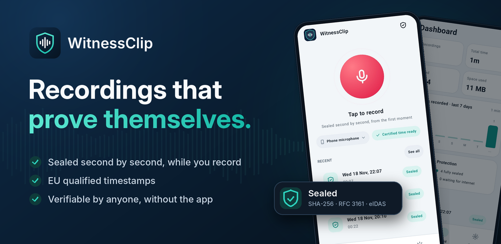
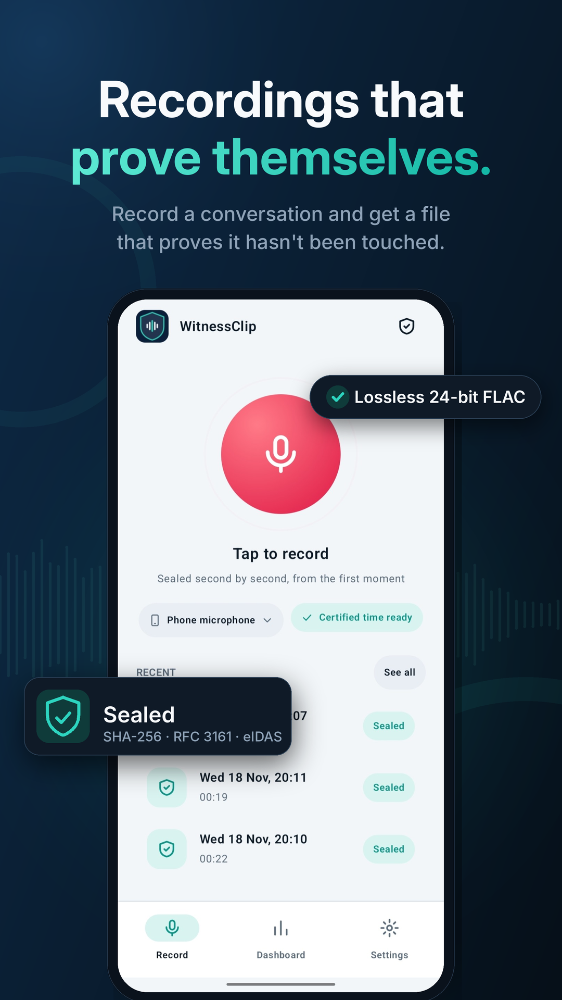
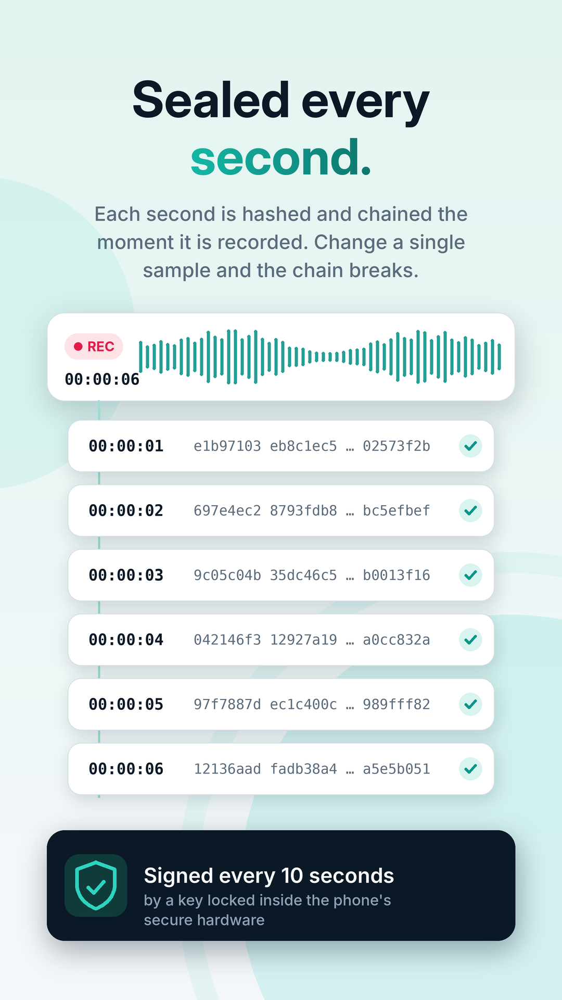
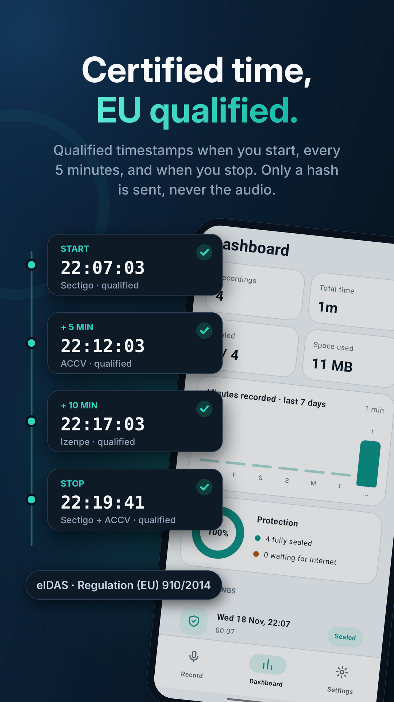
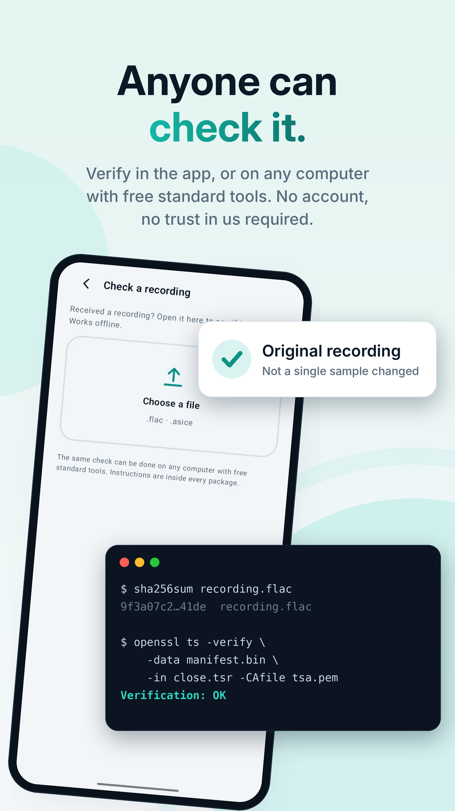
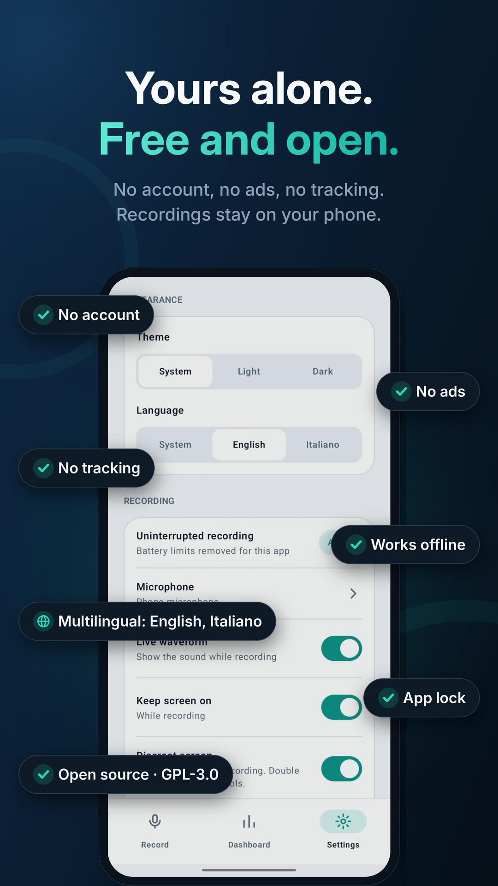

<p align="center">
  
</p>

<h1 align="center">WitnessClip</h1>

<p align="center">
  Record a conversation you are part of, and get a file that proves it hasn't been touched.
</p>

<p align="center">
  <a href="LICENSE"></a>
  
  <a href="docs/REPRODUCIBLE.md"></a>
</p>

<p align="center">
  <a href="https://apps.obtainium.imranr.dev/redirect?r=obtainium://add/https://github.com/HexRelic/WitnessClip">
    
  </a>
</p>

WitnessClip is an Android voice recorder built for one job: making a recording you can use as
evidence. When a recording ends up in front of a judge, the first question is usually whether
it was edited. Most recorders can't answer that. WitnessClip seals the audio while you are
still recording, so anyone can later check that nothing was changed and when it was made,
without needing the app or trusting its author.

The app is in English and Italian.

## Contents

- [Screenshots](#screenshots)
- [How it works](#how-it-works)
- [Features](#features)
- [Verifying a recording](#verifying-a-recording)
- [Installing](#installing)
- [Building](#building)
- [Repository layout](#repository-layout)
- [Documentation](#documentation)
- [Contributing](#contributing)
- [Responsible use](#responsible-use)
- [Use of AI](#use-of-ai)
- [Author](#author)
- [License](#license)

## Screenshots

<p align="center">
  
  
  
  
  
</p>

## How it works

Every second of audio is hashed with SHA-256 as soon as it is captured, and the hashes are
chained in a Merkle tree. Every ten seconds a key stored in the phone's secure hardware signs
the tree. That key is created fresh for each recording, can't be copied out of the phone, and
is destroyed once the recording is sealed.

Time comes from EU qualified timestamp services (Sectigo, ACCV and Izenpe). The app asks for
a timestamp when the recording starts, every five minutes while it runs, and twice at the
end. Only a hash is sent, never the audio. The services are free and need no account.

The result is a normal FLAC file that plays in any player and carries all of this proof
inside it. Change one sample, cut a second, or try to move the date, and verification fails
at the exact point where the file was altered.

The full reasoning, including what each check does and doesn't establish, is in
[What a recording proves](docs/TRIAL-GUARANTEES.md).

## Features

- Lossless 48 kHz / 24-bit recording, mono or stereo
- Phone, wired, USB or Bluetooth microphone
- Keeps recording with the screen off; interruptions are recorded in the seal, not hidden
- No pause and no editing. You can start, stop, mark a moment and add a note
- Recovers and seals a recording if the app is killed or the battery dies
- PDF/A report and an ASiC-E evidence package for your lawyer, with optional split export
  for court filing systems
- Built-in verifier, plus a command-line one for computers
- Optional location, app lock and discreet screen
- Works offline. No account, no ads, no analytics

## Verifying a recording

On any computer with JDK 17, from a checkout of this repository:

```bash
./gradlew :core:run --args="/path/to/recording.flac"
```

You don't have to use this verifier. Every evidence package includes a `VERIFY.txt` that
walks through the same checks with `sha256sum`, `ffmpeg` and `openssl`.

## Installing

All three ways below install the same APK, signed with the same key, so you can switch between
them without reinstalling.

- **Obtainium:** tap the badge at the top of this page on your phone, or add
  `https://github.com/HexRelic/WitnessClip` in Obtainium. It installs from the releases page
  and keeps the app updated.
- **F-Droid, Droid-ify or Neo Store:** add the HexRelic repository at
  `https://hexrelic.github.io/fdroid/repo`. The client checks the repository key against this
  fingerprint:

  ```
  BB1709DC3912D984DF24876838BCF2A168500F2072516125BA6C3BF942E1731E
  ```

  Or scan this QR code with the client, or open
  [this link](https://fdroid.link/#https://hexrelic.github.io/fdroid/repo?fingerprint=BB1709DC3912D984DF24876838BCF2A168500F2072516125BA6C3BF942E1731E)
  on your phone; both add the address and fingerprint in one step.

  <a href="https://hexrelic.github.io/fdroid/repo/index.png"></a>
- **Manually:** download the APK from the
  [releases page](https://github.com/HexRelic/WitnessClip/releases).

Before installing manually, compare the signing certificate with the one published in
[docs/REPRODUCIBLE.md](docs/REPRODUCIBLE.md).

## Building

You need JDK 17 and the Android SDK (platform 36, build-tools 36.0.0).

```bash
git clone https://github.com/HexRelic/WitnessClip.git
```

```bash
cd WitnessClip && ./gradlew :core:test :app:assembleDebug
```

Release builds are reproducible: building the same tag gives a byte-identical APK, so you can
confirm that the published app comes from this source. See
[docs/REPRODUCIBLE.md](docs/REPRODUCIBLE.md).

## Repository layout

- `core/` is plain Kotlin with no Android code: the sealing log, FLAC encoder and decoder,
  timestamp client, attestation parser, the verifier, and the PDF/A and ASiC-E writers.
- `app/` is the Android app: capture service, keys, crash recovery, export and the UI.
- `docs/` has the longer documentation.
- `tools/` has the scripts for reproducibility checks, release signing and licence checks.

## Documentation

- [What a recording proves](docs/TRIAL-GUARANTEES.md), for lawyers and court experts
- [Architecture](docs/ARCHITECTURE.md)
- [Reproducible builds and releases](docs/REPRODUCIBLE.md)
- [Third-party components](docs/DEPENDENCIES.md)

## Contributing

Bug reports and pull requests are welcome; see [CONTRIBUTING.md](CONTRIBUTING.md). Testing on
different phones is the most useful thing right now. Changes are listed in
[CHANGELOG.md](CHANGELOG.md).

Please report security problems privately, as described in [SECURITY.md](SECURITY.md).

## Responsible use

WitnessClip is a technical tool and doesn't give legal advice. It's up to you to make sure that
recording, keeping and using a conversation is allowed where you are. If in doubt, ask a
lawyer.

## Use of AI

The app has been developed by me (HexRelic, a human) with the aid of frontier large language
models (LLMs) to speed up development, testing and patching. The app itself contains no AI:
recordings are never analysed, transcribed, enhanced or altered.

## Author

WitnessClip is made by [HexRelic](https://github.com/HexRelic). Contact:
roundish-old-comic@duck.com

## License

Copyright (C) 2026 HexRelic.

The code is licensed under the [GNU GPL, version 3 or later](LICENSE). The WitnessClip name
and icon are trademarks and are not covered by the code license; see
[TRADEMARK.md](TRADEMARK.md). If you fork the project, please use a different name and icon.

The PDF reports use the Liberation Sans font, under the SIL Open Font License 1.1.
