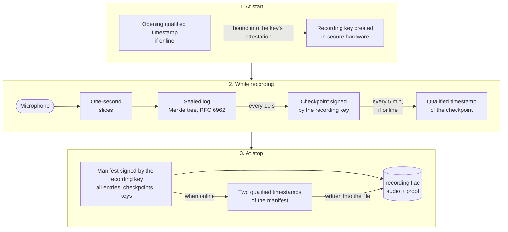
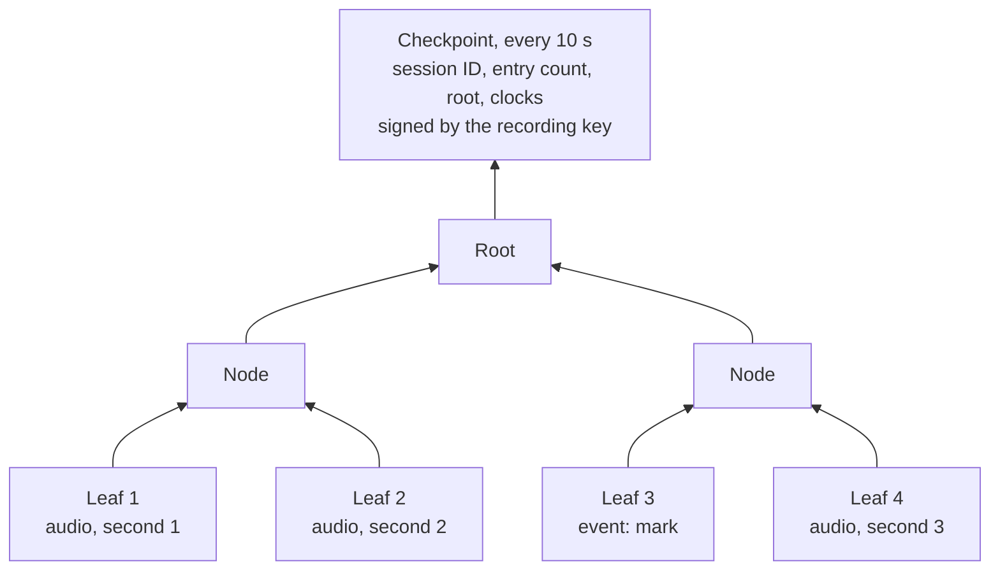

# Architecture

How WitnessClip 0.1.0 works inside. What a recording proves, explained for lawyers and
court experts, is in [TRIAL-GUARANTEES.md](TRIAL-GUARANTEES.md). Building and releasing is
covered in [REPRODUCIBLE.md](REPRODUCIBLE.md).

The `core` module has 13 automated tests that run on any JVM, including tests against the
live timestamp services.

## Contents

- [1. Overview](#1-overview)
- [2. Capture](#2-capture-app-recorderkt)
- [3. The sealed log](#3-the-sealed-log-core-merklekt-sealerkt-modelkt)
- [4. Keys](#4-keys-app-keyskt)
- [5. Certified time](#5-certified-time-core-tsakt)
- [6. Storage and crash recovery](#6-storage-and-crash-recovery-app-appkt-finisherkt)
- [7. The evidence file](#7-the-evidence-file)
  - [7.1 Self-proving FLAC](#71-self-proving-flac)
  - [7.2 Export](#72-export-app-exportkt-core-exporterkt-asickt-pdfpdfakt)
- [8. The verifier](#8-the-verifier-core-verifierkt)
- [9. User interface](#9-user-interface-app-mainactivitykt-screenskt-stringskt-uithemekt)
- [10. Permissions and network](#10-permissions-and-network)
- [11. Build and supply chain](#11-build-and-supply-chain)

## 1. Overview



While recording, the audio and every log entry are written to disk as they happen
(`frames.bin` and `journal.jsonl`), so an interrupted recording can still be recovered and
sealed; see [6. Storage and crash recovery](#6-storage-and-crash-recovery-app-appkt-finisherkt).

Two modules:

| Module | Contents | Runs on |
|---|---|---|
| `core/` | Sealed log, FLAC encoder and decoder, manifest format, timestamp client, attestation parser, verifier, split export, ASiC-E/CAdES writer, PDF/A writer, command-line verifier | Any JVM, no Android code |
| `app/` | Capture service, hardware keys, storage, crash recovery, export, report, user interface | Android 9 (API 28) and later |

Everything that decides whether a recording is valid lives in `core/`, so the same code
verifies a file inside the app and on a computer.

No native code, no Google Play Services, no analytics, no crash reporting, no server of ours.

## 2. Capture (`app`, `Recorder.kt`)

| Aspect | What the code does |
|---|---|
| API | `AudioRecord`, floating-point samples (16-bit fallback, fixed at the first open so a file is uniform) |
| Source | `UNPROCESSED` where the phone supports it, else `VOICE_RECOGNITION`; `VOICE_COMMUNICATION` for Bluetooth |
| Format | 48 kHz, 24-bit, mono by default, stereo if switched on and the phone has a stereo input |
| Gain | One constant, declared value: +30 dB (unprocessed), +12 dB (voice recognition), 0 dB (Bluetooth). No automatic gain control. The value is sealed in the log and in the manifest |
| Clipping | A second in which a sample reached full scale is flagged in its log entry |
| Slices | Exactly one second of PCM per log entry; the last one may be shorter |
| Clocks per slice | Audio hardware clock (`AudioTimestamp`, boot time base) with fallback to the system monotonic clock, plus wall clock |
| Input device | The device actually routed (type, name, built-in or not) is recorded; a change mid-recording is a sealed `route` event |
| Keep-alive | Foreground service of type `microphone`, partial wake lock, `START_NOT_STICKY` |
| Controls | Start, stop (hold), mark moment, add note. No pause, no edit, no trim |

Interruptions (the system taking the microphone, an input failure, a change of
microphone, storage running out) are sealed as events at their exact position. See
[TRIAL-GUARANTEES.md](TRIAL-GUARANTEES.md#5-continuity).

Optional inputs and context:

- Microphone choice: phone microphone, wired headset, USB, or Bluetooth headset (classic
  SCO and LE Audio). Bluetooth voice links are narrow-band and processed by the headset; the
  manifest says `voice-communication (bluetooth)`, so this is declared, not hidden.
- Stereo: off by default. Falls back to mono if the phone has no stereo input.
- Location (off by default, needs the permission): the position is followed for the whole
  recording (the service then also declares the `location` foreground type, so it keeps working
  with the screen locked). The first fix is sealed as the start position and the latest as the
  end position, each with latitude, longitude, accuracy, provider and fix time. If the phone
  gives no position, a `location-unavailable` event says why. It is what the phone says, not
  certified by anyone, and the report labels it that way.

## 3. The sealed log (`core`, `Merkle.kt`, `Sealer.kt`, `Model.kt`)

A Merkle tree exactly as in RFC 6962 (Certificate Transparency). Every second of audio and
every event is a leaf; the root covers all of them:



How each hash is computed:

```
leaf  = SHA-256( 0x00 ‖ entry bytes )
node  = SHA-256( 0x01 ‖ left ‖ right )
```

Entry kinds:

| Kind | Content |
|---|---|
| `a` audio | SHA-256 of that second's PCM (little-endian, interleaved), frame count, hardware clock, wall clock, flags (silent, overrun, clipped), input device index |
| `e` event | A small JSON object: `start`, `anchored`, `mark`, `note`, `gap`, `resumed`, `route`, `location`, `stop`, `interrupted` |

Each entry is bound to the recording's random 16-byte session ID and to its own position, so
entries cannot be moved between recordings or reordered.

Every 10 seconds the app signs a checkpoint: (session ID, number of entries, tree root,
clocks). Signing runs on its own thread so a slow secure chip never delays capture.

The hashes cover decoded audio samples, not file bytes. That is what allows the proof to be
stored inside the audio file itself, and allows the file to be re-encoded losslessly or split
without breaking the seal.

## 4. Keys (`app`, `Keys.kt`)

| Key | Lifetime | Purpose |
|---|---|---|
| Device key | Created once per installation, never exported, never backed up | Identifies the installation. Device ID = SHA-256 of its public key (shown as the first 32 hex digits). Endorses every recording key |
| Recording key | Created for one recording, destroyed when that recording is sealed | Signs the checkpoints and the manifest |

Both are ECDSA P-256 keys generated inside the Android Keystore: StrongBox (separate secure
chip) if present, else the TEE, each with hardware key attestation. If the phone offers
no attestation, an unattested key is used and the level is recorded.

The recording key's attestation challenge is `SHA-256` over the session ID and the opening
timestamp token. The certificate chain produced by the secure hardware therefore states that
this key was created for this session, after that timestamp existed.

After sealing, the recording key is deleted: nothing more can ever be signed in that
recording's name, not even by the same phone.

Official build pinning (`core`, `Release.kt`): Android writes the signing certificate of
the app that created a key into the attestation. The release certificate is pinned, so the
verifier reports the attestation as confirmed only for recordings made by the official build.

## 5. Certified time (`core`, `Tsa.kt`)

RFC 3161 timestamps from three free, public endpoints. No account, no cost, no server of ours.

| Provider | Endpoint | Pinned key (SHA-256 of public key, first digits) |
|---|---|---|
| Sectigo (Europe) SL | `http://timestamp.sectigo.com/qualified` | `dfa41c48…` (Sectigo Qualified Time Stamping CA R35) |
| ACCV (Spain) | `http://tss.accv.es:8318/tsa` | `002385de…` (TSA1 ACCV 2016) |
| Izenpe (Spain) | `http://tsa.izenpe.com` | `add78437…` (tsa.izenpe.com 2025) |

Each pinned key belongs to a service listed as a qualified timestamp service, status
"granted", on Spain's national trusted list (list issued 4 November 2026, checked 15 November
2026 with `tools/tsl_check.py`). A token that does not verify under one of these keys is
refused when it arrives and is not counted by the verifier.

Only a 32-byte hash is sent. The connection is plain HTTP, as is normal for RFC 3161; the
response is protected by its own signature, not by the transport. Cleartext is allowed for
these three hosts only (`res/xml/network.xml`).

| Timestamp | Taken over | When | What it establishes |
|---|---|---|---|
| Opening | A fresh random number | At start, if online | The recording key, whose attestation contains this token, did not exist before this instant |
| Intermediate | A signed checkpoint | Every 5 minutes, if online | Everything up to that checkpoint already existed, sealed, at this instant |
| Closing (two, from different providers when possible) | The signed manifest | At stop, or automatically at the first connection afterwards | The whole recording existed unchanged at this instant |

The opening timestamp arrives a moment after capture has started. The sealed `anchored` event
records how much audio existed at that point, and the verifier uses it.

Offline recording works the same without the opening and intermediate tokens. The closing
tokens are added when the phone is next online; until then the recording is shown as
"waiting for certified time".

## 6. Storage and crash recovery (`app`, `App.kt`, `Finisher.kt`)

App-private storage, excluded from every backup and device transfer. One folder per recording:

| File | While recording | After sealing |
|---|---|---|
| `frames.bin` | FLAC frames, flushed every second, forced to disk every 5 s | deleted |
| `journal.jsonl` | Every log entry, checkpoint, input device and timestamp as it happens | deleted |
| `recording.flac` | – | The sealed file: audio plus proof |
| `meta.json` | List entry (title, duration, waveform). Not part of the seal | same |

The sealed file is written under a temporary name, forced to disk, and only then renamed.

On every start the app looks for unfinished recordings:

1. If a complete sealed file exists, it is put back in the list as it is. It is never rebuilt
   or deleted.
2. Otherwise the journal is replayed against the audio on disk. Each second is kept only if
   its audio is present and matches the hash sealed at the time.
3. An `interrupted` event is added and the recording is sealed with end reason `interrupted`.
4. Live checkpoints and intermediate timestamps are kept only if the original recording key
   still exists. If it does not, a new key seals the file and the earlier checkpoints are
   dropped, because a new key cannot vouch for them.

## 7. The evidence file

### 7.1 Self-proving FLAC

`recording.flac` is an ordinary FLAC file, playable anywhere. A FLAC "application" metadata
block (ID `AEv1`, split in pieces of 8 MB, at most 96 MB) carries a small ZIP:

| Entry | Content |
|---|---|
| `evidence.json` | The manifest (format `audio-evidence/1`): app, audio format, phone model and OS, keys and certificate chains, opening timestamp, input devices, every log entry, every checkpoint, intermediate timestamps, root, end reason |
| `evidence.sig` | Signature of the manifest by the recording key |
| `open.tsr` | Opening timestamp token |
| `close-N.tsr`, `close-N.txt` | Closing timestamp tokens and their provider |
| `part.json` | Only in a split part: which seconds this part holds |

The encoder and decoder are our own Kotlin code (fixed predictors with Rice coding, 16 and 24
bit, mono and stereo with left/side coding). The same input always gives the same bytes, and
the tests compare the output with ffmpeg.

### 7.2 Export (`app`, `Export.kt`; `core`, `Exporter.kt`, `Asic.kt`, `pdf/PdfA.kt`)

| Export | What it is |
|---|---|
| Save audio | The single `.flac`, to a folder the user picks or to the default folder from Settings |
| Evidence package | An ASiC-E container (ETSI EN 319 162-1) with the audio, the report, `VERIFY.txt`, and a CAdES signature by the device key over the list of files |
| Split package | The recording cut into parts of at most 25 MB. Every part is a valid sealed file on its own and carries the full manifest, so each one verifies independently against the same root |
| Report | PDF/A-2b, Italian or English, with the font embedded (Liberation Sans). Written by our own small PDF writer |

The lawyer can add their own qualified signature to the ASiC-E package without touching ours.

## 8. The verifier (`core`, `Verifier.kt`)

One function, used by the app, by the command line and by the tests. It never throws: every
problem becomes a failed check. Sizes are bounded before anything is allocated, so a hostile
file cannot exhaust memory.

| Check | Fails when |
|---|---|
| `signature` | The manifest is not signed by the recording key |
| `log` | The recomputed tree root differs, or any live checkpoint is invalid or out of order |
| `audio` | Any second's audio does not hash to its entry; audio after the sealed end; FLAC length or checksum inconsistent |
| `device` | The Device ID is not the hash of the device key, or the device key did not endorse the recording key |
| `time-open` | The opening token is invalid |
| `time-mid` | An intermediate token is invalid, out of order, later than the closing time, or more audio lies between two certified instants than the time that passed between them |
| `time-close` | A closing token is invalid, earlier than the opening, or the file holds more audio than fits between opening and closing |
| `time-issuer` | (warning) a token is valid but not from a pinned qualified service; it is not counted |
| `attestation` | The certificate chain is broken or the key was not created for this session. Reported as confirmed only when the chain ends in a Google root, the key is in secure hardware, the boot state is verified, the bootloader is locked and the app is the official one |
| `continuity` | (warning) declared interruptions, silence imposed by the system, an unexplained difference between sample count and device clock, or an end reason other than the user |

Attestation that is present but not fully confirmed is recorded in the technical data without
a verdict; the app and the report show it only when it is positively confirmed or
cryptographically broken.

Command line:

```bash
./gradlew :core:run --args="/path/to/recording.flac"
```

Without our code, the same checks can be done with `sha256sum`, `ffmpeg`, `openssl ts` and
`openssl cms`; the steps are in the `VERIFY.txt` inside every package.

## 9. User interface (`app`, `MainActivity.kt`, `Screens.kt`, `Strings.kt`, `ui/Theme.kt`)

Jetpack Compose, one activity, light and dark theme, Italian and English.

| Screen | Purpose |
|---|---|
| Home | Start a recording, list of recordings, microphone choice |
| Recording | Timer, live waveform, mark moment, add note, hold to stop; optional discreet (dark) screen |
| Detail | Read-only player, proof summary in plain words, rename, save, export |
| Verify | Check any `.flac` or package from the phone's storage |
| Dashboard | Totals and activity |
| Settings | Theme, language, microphone, stereo, location, discreet screen, app lock, default save folder, battery exemption and brand guide (Samsung, OPPO/OnePlus), Device ID, legal pages |

App lock: optional. Uses the phone's own fingerprint, face or PIN; locks again after 20
seconds out of sight; keeps the content out of screenshots and the recent-apps preview. It
protects against someone picking up the unlocked phone.

The name a user gives a recording is a label in the list only and is not part of the seal.

## 10. Permissions and network

| Permission | Why |
|---|---|
| `RECORD_AUDIO`, `FOREGROUND_SERVICE`, `FOREGROUND_SERVICE_MICROPHONE`, `WAKE_LOCK` | Recording with the screen off |
| `POST_NOTIFICATIONS`, `VIBRATE` | The recording notification and alerts |
| `INTERNET`, `ACCESS_NETWORK_STATE` | Timestamp requests only |
| `REQUEST_IGNORE_BATTERY_OPTIMIZATIONS` | Asking the user to exempt the app from battery saving |
| `USE_BIOMETRIC` | App lock |
| `MODIFY_AUDIO_SETTINGS`, `BLUETOOTH` (Android 11 and earlier) | Bluetooth microphones |
| `ACCESS_COARSE_LOCATION`, `ACCESS_FINE_LOCATION`, `FOREGROUND_SERVICE_LOCATION` | Optional location, asked only when the user switches it on |

The only network traffic is the timestamp requests: a 32-byte hash goes out, a signed token
comes back. Audio, notes, names and location never leave the phone unless the user exports them.

## 11. Build and supply chain

| Item | Value |
|---|---|
| Language and tools | Kotlin 2.2.20, Android Gradle Plugin 8.13.0, Gradle 8.14.3, JDK 17 |
| Libraries | AndroidX and Compose (Apache-2.0), kotlinx (Apache-2.0), Bouncy Castle 1.79 (MIT-style). Full list with licences: [DEPENDENCIES.md](DEPENDENCIES.md) |
| Dependency integrity | SHA-256 of every artifact pinned in `gradle/verification-metadata.xml` |
| Release build | Unsigned, no shrinking or obfuscation, reproducible byte for byte: [REPRODUCIBLE.md](REPRODUCIBLE.md) |
| APK structure | Every build is checked entry by entry (`checkApkStructure`) so it cannot contain the malformed ZIP entries behind the "GhostMap" boot-loop bug |
| Licence | GPL-3.0-or-later; name and icon are trademarks ([TRADEMARK.md](../TRADEMARK.md)) |
